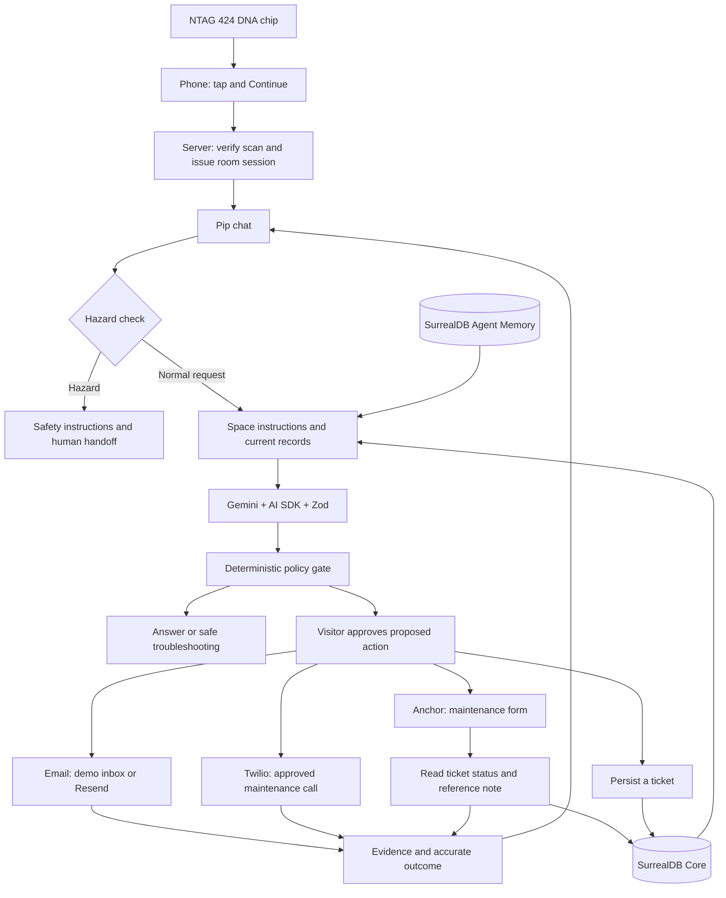

# SIGNAL — Every space has a memory.

**Tap. Ask. Resolve.** SIGNAL gives a physical space a contextual assistant named **Pip**. A visitor taps an NFC chip, gets help grounded in the room’s instructions and previous reports, and approves any action that files or escalates a report. The visitor does not need to find the maintenance team’s phone number, email address, or reporting form.

Hackathon focus: **SurrealDB Agent Memory**, **Anchor Browser**, and **Daytona**.

- [Live app](https://signal-three-iota.vercel.app)
- [Maintenance desk: projector ticket P-202](https://signal-three-iota.vercel.app/demo/maintenance?ticket=P-202)
- [Integration health](https://signal-three-iota.vercel.app/api/health)
- [Phone demo script](docs/12_PHONE_DEMO.md)

This README describes the implementation and observed status on **October 16, 2026**. Configuration flags show what is enabled; they do not prove that an external action succeeded. Seeded incident history is synthetic and labelled as demo data.

## How it works

1. **Tap a place-specific chip.** The phone opens `/t`. Merely loading this page does not consume the scan. Pressing **Continue** sends the chip’s dynamic fields to `POST /api/tap/redeem`.
2. **Establish the room context.** In verified mode, SIGNAL checks the NTAG 424 DNA SUN/SDM message, resolves the chip to a space, checks its read counter, and issues a signed, location-scoped session. The tab stores the session in `sessionStorage` and sends it in the `x-signal-session` header. NFC-only spaces enforce access on the server.
3. **Describe the issue to Pip.** SIGNAL checks hazards before calling a model. For normal requests it loads the operator’s equipment instructions and FAQs, recalls location-labelled Agent Memory, and reads current incidents from SurrealDB Core.
4. **Use history to choose the next step.** A deterministic matcher identifies related reports. Gemini returns a Zod-validated decision: answer a question, offer a safe fix, link an existing incident, ask a clarification, or propose a new report. A server policy gate evaluates the proposal.
5. **Approve an action.** The visitor sees an approval button, and a report draft for email or external forms. Approval identifiers are signed and bound to the action, location, and target. Pip explains when an approved submission or call is starting.
6. **Perform and check the action.** SIGNAL persists a ticket, starts an Anchor browser task, submits an email, or places an approved call. The phone shows an action card and polls for the outcome. A portal update is confirmed only when a database read finds both the requested status and the action’s reference note.
7. **Keep the evidence and learn carefully.** Core stores incident status, work notes, action attempts, and audit events. Agent Memory stores sourced knowledge and observations. A visitor saying “That fixed it” becomes an explicitly unconfirmed observation, not proof that maintenance repaired the asset.



## What each tool does

| Tool | Role in SIGNAL | Implementation / boundary |
|---|---|---|
| **Expo SDK 58 + Expo Router** | One React Native codebase for web and potential native builds; screens and server API routes. | The demonstrated flow is responsive web opened from NFC. `web.output: "server"` exports the client and server bundles. API routes live in `src/app/api/**/*+api.ts`. |
| **React + React Native Web + TypeScript** | Pip chat, the maintenance desk, and operator screens. | Strict TypeScript; shared visual tokens and accessible controls. Native builds are not established as a tested deliverable here. |
| **Vercel** | Hosts static assets and the Expo server handler. | `api/index.js` uses `expo-server/adapter/vercel`. `vercel.json` includes the server bundle and sets a 60-second function duration. |
| **Gemini** | Produces a structured troubleshooting / escalation decision from supplied context. | Default primary: `gemini-3.8-flash`, medium thinking. Fast fallback: `gemini-3.5-flash-lite`, minimal thinking. The model does not choose contact destinations or decide whether an action succeeded. |
| **Vercel AI SDK + Zod** | Calls Gemini and validates its decision shape. | `generateObject` uses `DecisionSchema`; the policy gate and action endpoints enforce permissions separately from model output. |
| **SurrealDB Agent Memory** | Recalls previous problems, fixes, profiles, and visitor observations with provenance. | Official `@surrealdb/memory` client. Current retrieval uses `location=<id>` labels and hybrid recall. Literal writes use `infer: 'none'`. Registered hierarchical scopes are a future step. |
| **SurrealDB Core** | Authoritative operational records: spaces, incidents, action attempts, demo email, and audit. | The `surrealdb` client in `src/lib/core.ts`. Missing Core credentials select a labelled in-process demo store, which is not durable across serverless instances. |
| **Anchor Browser** | Fills the maintenance form after approval. | REST calls use the installed SDK’s types; its runtime import is avoided because it pulls Playwright into Metro. Owned-portal writes are verified through Core read-back. External forms remain submitted/unverified. |
| **ElevenLabs** | Generates Pip’s five short voice cues. | `npm run cues` writes cached MP3s to `public/audio`. Playback requires visitor opt-in and has text captions and replay controls. Full chat answers are currently text; ElevenLabs is not the current maintenance-call voice. |
| **Twilio Programmable Voice** | Places the approved outbound maintenance call and reports call status. | The current call reads a fixed report using TwiML `<Say voice="Polly.Joanna-Generative">`. It cannot take replies. Destination is restricted to `DEMO_APPROVED_PHONE_E164`. |
| **Resend** | Optional real email escalation to the operator-configured recipient. | `EMAIL_MODE=resend` uses Resend. Default `EMAIL_MODE=demo` stores and reads back a message in SIGNAL’s own inbox; it sends no real email. |
| **Arize Phoenix + OpenTelemetry** | Instrument chat, recall, model, policy, and tool spans. | `src/lib/tracing.ts` uses Phoenix OTEL and OpenInference attributes. Export is a no-op without `PHOENIX_COLLECTOR_ENDPOINT`; evaluations do not grant action permissions. |
| **Daytona** | Runs reproducible development checks in a fresh sandbox. | `npm run daytona:smoke` uploads source while excluding local env files, installs dependencies, typechecks, and runs NFC tests. `--serve` also builds and exposes a preview. Daytona does not host permanent memory or production data. |
| **NXP NTAG 424 DNA** | Produces dynamic NFC URL fields that the server can authenticate. | AES/CMAC SUN/SDM verification is implemented in `src/lib/nfc`. This authenticates a chip-generated message; it does not establish the visitor’s identity or GPS location. |

An Anthropic SDK is installed, but the active chat provider is Google/Gemini. ElevenLabs conversational-agent environment fields are reserved for a possible later call integration; the current call route uses Twilio directly.

## Memory, status, and verification

**Agent Memory answers “what has happened here, and what might help?” Core answers “what is the current incident and action record?”** A related memory hit is not sufficient proof that a current incident matches; the deterministic report matcher supplies that additional check.

Source text and timestamps distinguish synthetic fixtures, operator profiles, visitor reports, and visitor-reported fixes. When knowledge changes, preserve history and record supersession. The profile text already describes supersession; complete structured supersession relationships remain unfinished.

| Outcome | What it actually establishes |
|---|---|
| Incident saved | Core persisted the report; this does not prove staff have responded. |
| Owned portal `VERIFIED` | Read-back found the requested incident status and the attempt’s reference note. It verifies the record update, not the physical repair. |
| External form `AGENT_REPORTED` | Anchor reports a submission and site confirmation; SIGNAL cannot independently read back that third-party record. |
| Demo email `VERIFIED` | The message exists in SIGNAL’s own demo inbox and was read back. No real email was sent. |
| Real email accepted | Resend accepted the message; delivery and reading remain unconfirmed. |
| Call `INITIATED` | Twilio accepted the call request; it may still fail or go unanswered. |
| Call `VERIFIED` | The code maps Twilio’s completed call with positive duration to this state. The accompanying evidence distinguishes completion from acknowledgement; no human acknowledgement is collected. |
| Visitor reports a successful fix | An observed, unconfirmed memory item; it does not automatically resolve an authoritative incident. |

The model may propose an action. Approval checks, fixed destinations, action-attempt records, and audit logic live on the server. In-flight attempt reuse and the call cooldown are implemented; these should not be presented as a complete, transactionally enforced idempotency system for every action.

## Demo: a room remembers, then acts

The default demo space is **Pitch Area**. Its seeded history includes an open right-projector report **P-202**, originally reported two days before the fixture reset, with a replacement-cable note. Room 204 is a second demo space with scenarios S1–S4.

1. On a laptop, open the [P-202 maintenance view](https://signal-three-iota.vercel.app/demo/maintenance?ticket=P-202).
2. On the phone, tap the NFC chip, press **Continue**, and enable Pip’s speaker. Show the verified badge only if it actually appears.
3. Type **“The right projector keeps going black.”**
4. Show the existing report and its dated note: the room remembers the issue, avoiding another duplicate ticket.
5. Approve **Add my report to P-202 and escalate**. Pip explains the submission; Anchor works on the owned maintenance form.
6. Wait for the actual outcome. If it is `VERIFIED`, refresh the laptop portal and point to the saved reference note. **“A click isn’t enough—SIGNAL checks the saved record before confirming the update.”**
7. Optionally approve the separate call while holding the pre-approved receiving phone. A ten-minute per-ticket cooldown limits repeated calls.

Another useful prompt is **“My laptop shows no signal on the left projector.”** The seeded resolved report records switching the laptop to Duplicate display mode, illustrating a sourced self-service fix.

The maintenance desk includes ticket/room/equipment search, status filters and counts, a selected-ticket view, readable activity history, work notes, character limits, and save/error feedback. Its stable ticket headings, status labels, note labels, and **Save update** controls remain available to Anchor.

See the [full phone demo script](docs/12_PHONE_DEMO.md). Rehearse the live Anchor flow before presenting; a manual portal save is a different test. Describe fixtures and backup recordings honestly.

## Current status and remaining work

Observed on October 16, 2026; production health was checked during this documentation update.

| Area | Evidence / remaining work |
|---|---|
| Deployment | Live on Vercel. Recent production builds and TypeScript checks passed. |
| Chat | Production requests returned 200 after deadline protection was added. A real-service test demonstrated the Gemini 3.5 Flash-Lite fallback. Billing, quotas, and demand can still affect either model. |
| Core | Production health reports `backend=surrealdb` and a successful probe. Nine demo incidents were visible in the maintenance API during portal verification. |
| Agent Memory | Production health probe succeeds. Earlier sourced write/recall smoke checks passed. Health alone does not validate every recall result. |
| Maintenance desk | Deployed; search, filtering, empty states, and a UI save followed by read-back passed against an isolated local demo store. Production reads and room/equipment labels were checked. |
| Anchor | Credentials and action flag are enabled. Start/poll/read-back code exists. A successful live browser update has not been established by the checks recorded in this chat. |
| NFC | Verified redemptions appeared in supplied production logs; parser/crypto tests pass. Replay tracking is still in process memory: it is best-effort across Vercel instances, even when Core is connected. |
| Pip audio | All five ElevenLabs clips were generated and deployed; production MP3 responses returned 200 and matched the generated files. Sound is opt-in. |
| Calls | Production health reports Twilio configured, an approved destination set, and calls enabled. A successful received call has not been established here. Production health reports webhook signing unavailable; polling provides the implemented status fallback. |
| Email | Demo mode stores messages without sending. Real Resend delivery requires its key, verified sender, and `EMAIL_MODE=resend`; this was not live-tested here. |
| Phoenix | Spans are implemented, but production health currently reports tracing disabled because no collector endpoint is set. Do not claim a captured trace until one is visible in Phoenix. |
| Daytona | An earlier clean-sandbox install/typecheck/NFC smoke run passed. It was not rerun for this documentation change. |

Before presenting: run the live Anchor rehearsal, verify one call if using it in the pitch, configure Phoenix and inspect a real trace, and complete the [mandatory test matrix](docs/06_SETUP_AND_HACKATHON.md). Before wider use: implement durable atomic replay protection, harden portal/operator access, complete action idempotency and supersession, and review privacy/retention and deployment controls. The owned maintenance portal is intentionally a demo portal, not a production admin-security reference.

## Run locally

The project has been built with Node.js 22. Dependencies and scripts are in [package.json](package.json).

```powershell
npm install
# New checkout only: copy the template, then enter credentials privately.
Copy-Item .env.example .env.local
npm run web
```

Open `http://localhost:8081`. Do not overwrite an existing `.env.local`. For a production-style local run:

```powershell
npm run typecheck
npm run build:web
npm run serve
```

Missing providers produce notices or degraded behaviour rather than invented results. A Core outage is not treated as an empty incident history. An NFC-only space still requires a valid tap session or operator preview; use the open Room 204 demo when testing without a chip.

### Environment configuration

Use [.env.example](.env.example) as the full variable reference. Configure only the integrations needed for the chosen flow, in `.env.local` for development and the appropriate Vercel environment for deployment.

| Capability | Server-side configuration |
|---|---|
| Sessions and operator tools | `APP_SESSION_SECRET`, `DEMO_OPERATOR_LOGIN_SECRET` |
| Chat | `GEMINI_API_KEY` (or `GOOGLE_GENERATIVE_AI_API_KEY`), `AI_MODEL`, `AI_FALLBACK_MODEL`, `AI_THINKING_LEVEL` |
| Agent Memory | `AGENT_MEMORY_ENDPOINT`, `AGENT_MEMORY_CONTEXT_ID`, `AGENT_MEMORY_API_KEY` |
| Core | `SURREALDB_URL`, `SURREALDB_NAMESPACE`, `SURREALDB_DATABASE`, `SURREALDB_USERNAME`, `SURREALDB_PASSWORD`; optional `SURREALDB_AUTH_LEVEL` |
| Browser actions | `ANCHORBROWSER_API_KEY`, public `MAINTENANCE_PORTAL_BASE_URL`, `ENABLE_ANCHOR_ACTIONS=true`; external portal settings come from the operator’s space profile |
| Generate Pip audio | `ELEVENLABS_API_KEY` with `text_to_speech` permission, `ELEVENLABS_VOICE_ID`; generation happens offline, and the deployed files play without a browser API key |
| Calls | `TWILIO_ACCOUNT_SID`, `TWILIO_PHONE_NUMBER`, `TWILIO_API_KEY` + `TWILIO_API_SECRET` or `TWILIO_AUTH_TOKEN`, `DEMO_APPROVED_PHONE_E164`, `ENABLE_OUTBOUND_CALLS=true` |
| Call callbacks | `TWILIO_AUTH_TOKEN` for signature validation, even when API-key credentials place the call; optional `PUBLIC_BASE_URL` |
| Email | `EMAIL_MODE=demo` by default; real sending needs `EMAIL_MODE=resend`, `RESEND_API_KEY`, and `EMAIL_FROM` |
| Tracing | `PHOENIX_COLLECTOR_ENDPOINT`, `PHOENIX_API_KEY` when required, optional `PHOENIX_PROJECT` |
| Daytona | `DAYTONA_API_KEY` |
| NFC | `NFC_MODE`, `NFC_SDM_META_KEY`, `NFC_SDM_FILE_KEY`, optional `NFC_KEY_STORE_REF`, and `NFC_TAGS` or operator chip mappings |

Secrets remain server-side; never use `EXPO_PUBLIC_` for keys. Do not commit `.env.local`. A configured chip needs tested SDM offsets and matching keys; factory-zero keys are only a bring-up convenience. See [NFC setup](docs/10_NFC_SETUP.md).

### Chat latency and fallback

The server returns one typed-event JSON batch, not a streamed response. The initial checking state does not identify which provider is currently running.

| Stage | Maximum application wait |
|---|---|
| Space access | 8 s |
| Memory and incident reads, running concurrently | 10 s for memory; 8 s for incidents |
| Primary Gemini attempt | 15 s |
| Fast Gemini fallback after primary failure | 10 s |
| Trace flush | 1 s |

Model calls use zero automatic retries and cancellation. If both attempts fail, Pip returns an explicitly labelled answer from available space records. Both models use the same Google credentials, so switching models cannot bypass depleted account credits. `chat.stage` logs record stage timing without prompt text. These budgets reduce timeout risk; they are not a guarantee against all hosting or network failures.

### Commands and checks

| Command | Purpose / side effects |
|---|---|
| `npm run typecheck` | Strict TypeScript check. |
| `npm run build:web` | Export Expo client and API bundles. |
| `npm run test:nfc` | Deterministic NFC parser and crypto tests. |
| `node --test scripts/chat-timeout.test.cjs` | Simulated hung-provider, fallback, and access regression tests. |
| `npm run smoke:core` | Exercise the configured Core connection; inspect the script before running against shared data. |
| `npm run smoke:memory` | Write and recall a sourced fact in the configured Agent Memory context. |
| `npm run nfc:check -- "<chip URL>"` | Check a chip URL locally; keep real scan URLs out of public logs. |
| `npm run cues` | Generate five cached ElevenLabs clips; uses provider quota. Deploy the resulting `public/audio` files. |
| `npm run daytona:smoke` | Create a sandbox, install, typecheck, run NFC tests, then delete the sandbox. |
| `npm run daytona:smoke -- --serve` | Also build/serve a preview; keeps the sandbox until it is deleted separately. |

Operator requests use `x-demo-secret: <DEMO_OPERATOR_LOGIN_SECRET>`:

- `POST /api/memory/seed`: seed all space profiles and Core incidents into Agent Memory.
- `POST /api/demo/reset`: restore demo reports; `?spaces=1` also resets space profiles. This mutates data; do not run during someone else’s rehearsal.
- `GET /api/audit`: inspect recorded audit events.

## Pages and API map

| Page / API | Purpose |
|---|---|
| `/t` → `POST /api/tap/redeem` | NFC landing, verification, redemption, and session issuance. |
| `/s/<space>` → `POST /api/chat` | Visitor chat, sourced guidance, and action approvals. `GET /api/chat` returns 405. |
| `POST /api/incidents`, `POST /api/feedback` | Approved report creation; visitor-reported fix observation. |
| `/admin`, `/admin/spaces` | Integration board and operator configuration of spaces, equipment, FAQs, escalation, and chips. |
| `/demo/maintenance`, `/api/portal/tickets`, `/api/portal/tickets/:id` | Owned demonstration portal and its Core-backed read/write endpoints. |
| `POST /api/actions/portal-update` | Start the approved Anchor task on the owned portal. |
| `POST /api/actions/external-report` | Start an approved report on an operator-configured HTTPS form. |
| `POST /api/actions/call`, `/api/webhooks/twilio/status` | Initiate a restricted call; receive signed status callbacks. |
| `POST /api/actions/email`, `/demo/inbox` | Submit approved email escalation; inspect the operator-only demo inbox. |
| `GET /api/actions/:id` | Poll action status; perform provider checks or owned-portal read-back. |
| `/api/spaces/resolve`, `/api/spaces/:id/faq` | Resolve visitor-safe space context and sourced quick prompts. |
| `/api/health`, `/api/audit` | Integration probes and operator audit inspection. |

```text
api/index.js                 Vercel entry point for the Expo server bundle
src/app/                     Screens and API route handlers
src/lib/agent/               Model setup, decision schema, policy, and report matching
src/lib/core.ts              Authoritative operational database / local demo fallback
src/lib/memory.ts            Agent Memory knowledge and provenance
src/lib/anchor.ts            Owned/external browser-task integration
src/lib/twilio.ts            Calls, callback validation, and outcome descriptions
src/lib/email.ts             Demo inbox and Resend delivery
src/lib/nfc/                 SUN/SDM verification, tag mapping, replay store, sessions
src/lib/tracing.ts           Phoenix / OpenTelemetry spans
src/design/                  Shared design system, maintained by the UI session
src/data/                    Synthetic incidents, spaces, FAQs, and scenarios
public/audio/                Cached Pip cues and their text manifest
scripts/                     Generation, smoke checks, and regression tests
docs/                        Product specification, setup, demo, and original playbook
```

## Deployment and further reading

`expo export -p web` produces `dist/client` and `dist/server`. Vercel serves the client and rewrites server requests to `api/index.js`. The project is GitHub-connected; pushes to its production branch trigger builds. Direct CLI production deployments were also used during integration. Set `MAINTENANCE_PORTAL_BASE_URL` to the publicly reachable owned portal because Anchor runs in the cloud. Native `anchorbrowser` runtime imports must stay out of the Metro server bundle; use type imports and the existing REST wrapper.

Long-running browser work is started asynchronously and checked by polling. A durable background job system and webhook-based continuation for broader workflows remain future work. Outbound calls and browser actions default to disabled in the environment template and must be explicitly enabled for a configured demo.

- [Product and scope](docs/01_PRODUCT_AND_SCOPE.md)
- [Architecture and contracts](docs/02_SYSTEM_ARCHITECTURE.md)
- [NFC security model](docs/03_NFC_SECURITY.md)
- [Memory and evaluation](docs/04_AGENT_MEMORY_AND_EVALUATION.md)
- [Brand and UX](docs/05_BRAND_AND_UX.md)
- [Setup and mandatory test matrix](docs/06_SETUP_AND_HACKATHON.md)
- [Pitch and roadmap](docs/07_PITCH_AND_ROADMAP.md)
- [Provider references and corrections](docs/08_REFERENCES_AND_CORRECTIONS.md)
- [Expo translation of the original playbook](docs/09_EXPO_STACK.md)
- [NFC provisioning and setup](docs/10_NFC_SETUP.md)
- [Current Twilio call implementation](docs/11_TWILIO.md)
- [Phone demo script](docs/12_PHONE_DEMO.md)

The original playbook assumed Next.js; the implementation uses **Expo Router + Vercel**. When older planning documents disagree with current behaviour, inspect the implementation and this dated status snapshot before making a demo claim.
