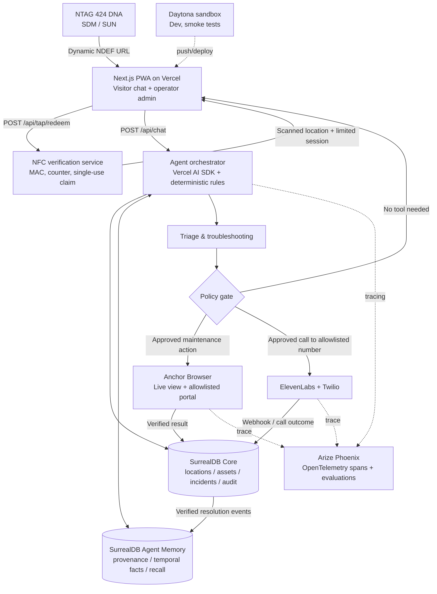

# 02 — System architecture and integration contracts

## Recommended topology



**Important separation:** Daytona is for fast development/testing; it is not where permanent memory lives. Vercel hosts the visitor/admin app and small APIs. For production, long browser/call operations should run asynchronously through a durable job runner with webhook callbacks, not stay attached to an HTTP request until completion.

## Data ownership

**SurrealDB Core = authoritative operations.** Records should be consistent and auditable: organization, location, asset, tag mapping, read counter, session, incident, report, technician resolution, call policy, audit log. These need transactionality, identity, access rules and idempotent updates.

**SurrealDB Agent Memory = retrieved knowledge/beliefs.** Holds equipment facts, historical patterns, causes, fixes, dated observations and provenance. A visitor statement is recorded as an unverified observation; a technician close-out creates a higher-confidence resolution record. When a fact changes, **record the supersession instead of silently erasing past state.** Do not call `memory.forget()` merely to hide a conflicting prior fact when the history is needed for operational traceability.

**Arize = evaluation/observability.** Trace latency, tool decisions, evidence retrieval and outputs; never use score alone as permission for a side effect.

## SurrealDB Core model (logical)

```text
organization 1──* site 1──* location 1──* asset
                                  │            │
                                  *──* tag      *──* incident
                                               │       │
                                             reports  resolution
                                               │       │
visitor_session 1──* agent_turn         action_attempts
                                               │
                                          external_ticket

org_policy / approved_contact / audit_event / nfc_redeem
```

Suggested record columns and invariants:

| Entity | Critical fields | Invariant |
|---|---|---|
| `organizations` | `id,name,plan,created_at` | All nonpublic data scoped to organization |
| `locations` | `id,org_id,site_id,display_name,timezone,emergency_copy` | Public context strips internal notes |
| `assets` | `id,location_id,type,model,public_troubleshooting` | Docs and risk classification versioned |
| `nfc_tags` | `id,location_id,key_ref,last_accepted_counter,state` | Store **key reference**, not raw key in Agent Memory |
| `nfc_redemptions` | `tag_id,counter,claim_hash,redeemed_at,session_id` | Unique `(tag_id,counter)`; server atomic operation |
| `visitor_sessions` | `id,location_id,scan_type,expires_at,anon_session_token_hash` | No default account; short lived; signed, httpOnly cookie |
| `incidents` | `id,location_id,asset_id,status,priority,external_id,created_at` | Status confirmed by authoritative adapter, not LLM guess |
| `reports` | `id,incident_id,session_id,summary,source,evidence` | Many reports can attach to one incident |
| `resolutions` | `id,incident_id,tech_id,fix_summary,verified_at` | Technician/owner verified; source linked |
| `action_attempts` | `id,decision_id,idempotency_key,type,state,result,trace_id` | Approval & audit required; retry safe |
| `approved_contacts` | `org_id,location_id,phone_e164,role,call_window,enabled` | Fixed allowlist; never arbitrary LLM-supplied number |
| `audit_events` | `actor,action,target,policy_decision,timestamp,trace_id` | Append-only, retention controlled |

### Incident status machine

`NEW → TRIAGING → OPEN → IN_PROGRESS → RESOLVED → CLOSED` plus `CANCELLED`.

**Do not** infer `RESOLVED` from agent language. Self-service fixes are `SELF_SERVICE_REPORTED_RESOLVED`, distinct from technician confirmation and the physical asset's verified status.

## API contract overview

| Method / path | Caller | Purpose | Security |
|---|---|---|---|
| `GET /t?<sdm-fields>` | NFC browser | Landing/preview; **does not consume** a scan | No secrets in rendered HTML; no side effects |
| `POST /api/tap/redeem` | User confirmation | Verify SUN/SDM; issue session | Atomic counter check, rate limit, CSRF/origin where relevant |
| `POST /api/chat` | Visitor | Stream response and typed status events | Valid session + location only; bounded turns |
| `GET /api/incidents?location=...` | Visitor/operator | Contextual display or admin data | Public summaries only for visitor; RBAC for full records |
| `POST /api/actions/approve` | Visitor/operator | Approve planned action | Intent-bound signed nonce, expiration and role check |
| `POST /api/escalations/call` | Server tool / approver | Initiate approved outbound call | Phone allowlist, priority threshold, idempotency, rate cap |
| `POST /api/webhooks/elevenlabs` | ElevenLabs | Call status / transcript summary | Verify provider webhook signature; minimize stored content |
| `POST /api/demo/reset` | Admin only | Reseed repeatable demo scenario | Disabled in production, signed admin authentication |
| `GET /demo/maintenance` | Agent browser / admin | Owned simulated maintenance portal | Isolated demo tenant; no external personal data |

## Chat event envelope

Avoid parsing free-form LLM text for state changes. Return typed events, e.g.:

```ts
type ChatEvent =
  | { type: 'avatar'; state: 'idle'|'listening'|'thinking'|'helping'|'solved'|'escalating' }
  | { type: 'text-delta'; text: string }
  | { type: 'step'; label: string; status: 'started'|'done'|'failed' }
  | { type: 'choice'; options: { id: string; label: string }[] }
  | { type: 'source'; title: string; factId: string; verifiedAt?: string }
  | { type: 'approval-required'; actionId: string; summary: string }
  | { type: 'completed'; outcome: string; incidentId?: string; traceId?: string };
```

Use Vercel AI SDK UI-message stream where compatible; a simple SSE/event adapter is acceptable if version-specific provider helpers differ. Do **not** use an unverified `toDataStreamResponse()` signature copied from old tutorials.

## Async orchestration and retries

- Keep browser and phone work outside synchronous chat completion when possible. Create `action_attempts` as `PENDING` and return a status card; process via durable job/queue or provider callbacks.
- Every side effect gets `idempotency_key = hash(tenant,incident,actionType,approvalVersion)`; write before execution; retry only when safe.
- Normalize tool result: `{attemptId, state, externalId?, verifiedBy, verifiedAt, evidence?, error?}`.
- Anchor Browser may click a button but fail to persist. Require a read-after-write or portal status confirmation before saying “ticket updated.”
- Telephony success at API dispatch means only *call initiated*, not “human notified.” Use provider status/callback and, ideally, acknowledged conversation intent to mark delivered.
- Failure modes: memory outage → basic help and ticket path; Anchor outage → create in-app incident and report external update pending; STT unavailable → text input; Vercel function timeout → async job continuation; tag verification unavailable → informational mode only, clearly labeled.

## Security boundaries

Browser tools must operate only on allowlisted domains; page text is **untrusted data**, not instructions. Distinguish agent internal instructions from scraped portal content. Strip or redact sensitive fields from traces. Enforce authenticated admin roles, tenant isolation, phone allowlists, rate limits, contact windows, and privacy-friendly retention.
